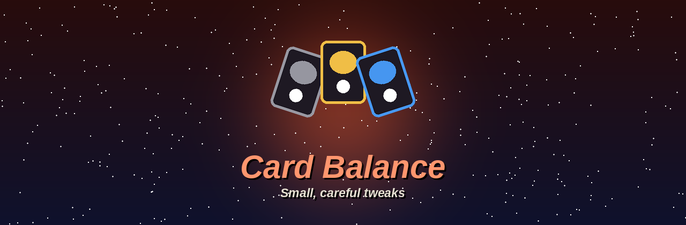

<p align="center"></p>

# Card Balance

Small, targeted card balance changes for Slay the Spire 2. Code-only (Harmony patches): no BaseLib, no `.pck`, no dependencies.

## Changes

| Card | Change |
| --- | --- |
| Master Planner | Costs 1 energy instead of 2, and 0 when upgraded. |

## Install

Subscribe on the Steam Workshop, or build it yourself (below) and restart the game; mods load only at startup. Enable it under Settings > Mod Settings.

This mod changes gameplay, so every player in a multiplayer lobby needs it.

## Build

```
dotnet build mods/CardBalance -c Release
```

Needs the game installed: the project compiles against the game's own `sts2.dll`, `0Harmony.dll` and `GodotSharp.dll`. The path is found by `build/Sts2PathDiscovery.props` (override with `/p:Sts2Path=...`). The build copies the `.dll`, `.pdb` and manifest `.json` to `<Slay the Spire 2>/mods/RasmusCardBalance/`; this fails while the game is running.

## How it works

Every `[HarmonyPatch]` class is applied by `MainFile.Initialize`, so a new tweak is one new file in `src/`. A card's base stats are set in its constructor, so a cost change is a transpiler on that constructor (see `src/MasterPlannerPatch.cs`). If a game update changes the expected IL, the patch logs an error to `%APPDATA%/SlayTheSpire2/logs/godot.log` and leaves the card unchanged.

Built against game version 0.111.0. Unofficial fan-made mod, not affiliated with Mega Crit.
