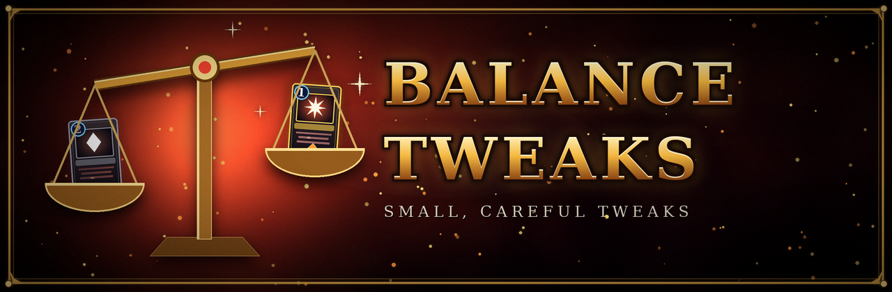

<p align="center"></p>

# Balance Tweaks

Small, targeted card and relic balance changes for Slay the Spire 2. Code-only (Harmony patches): no BaseLib, no `.pck`, no dependencies.

## Changes

| Card / Relic | Change |
| --- | --- |
| Master Planner | Costs 1 energy instead of 2, and 0 when upgraded. |
| Unceasing Top (relic) | Cards that can't be played (curses, statuses, etc.) don't count as a hand; if only those are left, it draws. Playable cards you just can't afford still count. |
| Calculated Gamble | Upgrading removes Exhaust instead of adding Retain. |
| Frozen Eye (relic) | Re-added as a shop relic: when viewing your Draw Pile, the cards are shown in draw order. |

## Turning changes on and off

Every change has its own checkbox under **Settings > General**, in the *Balance Tweaks* section at the bottom. All are on by default. Choices are saved to <user data>/RasmusCardBalance/settings.json (not the mod folder, whose .json files are read as manifests).

Changes take effect **after restarting the game**. Mods load only at startup and a disabled tweak is simply never patched in, which keeps the patches free of runtime checks (a cost, stat or keyword change applied mid-run would also leave existing cards and saved runs inconsistent). The section shows a reminder when your saved choices differ from what is active.

## Install

Subscribe on the Steam Workshop, or build it yourself (below) and restart the game; mods load only at startup. Enable it under Settings > Mod Settings.

This mod changes gameplay, so every player in a multiplayer lobby needs it, and the toggles must match: if one player turns a tweak off, the lobby's cards and relics will behave differently for them. Agree on the settings before starting a run.

## Build

```
dotnet build mods/CardBalance -c Release
```

Needs the game installed: the project compiles against the game's own `sts2.dll`, `0Harmony.dll` and `GodotSharp.dll`. The path is found by `build/Sts2PathDiscovery.props` (override with `/p:Sts2Path=...`). The build copies the `.dll`, `.pdb` and manifest `.json` to `<Slay the Spire 2>/mods/RasmusCardBalance/`; this fails while the game is running.

## How it works

A new tweak is a patch file in `src/` plus one entry in `Tweaks.All` (`src/Tweaks.cs`); the menu, saved settings and conditional patching follow from that. `MainFile.Initialize` patches each enabled tweak's class ; any other `[HarmonyPatch]` class (the settings menu patch) is applied unconditionally. A card's base stats are set in its constructor, so a cost change is a transpiler on that constructor (see `src/MasterPlannerPatch.cs`). If a game update changes the expected IL, the patch logs an error to `%APPDATA%/SlayTheSpire2/logs/godot.log` and leaves the card unchanged.

Built against game version 0.111.0. Unofficial fan-made mod, not affiliated with Mega Crit.
