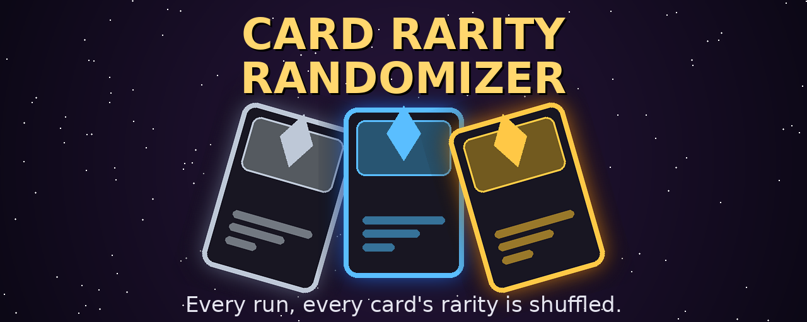
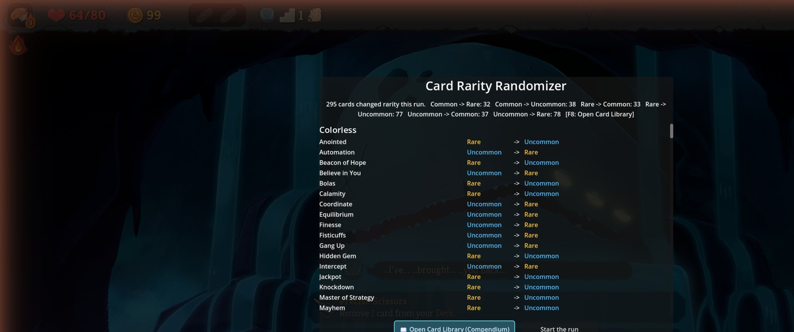
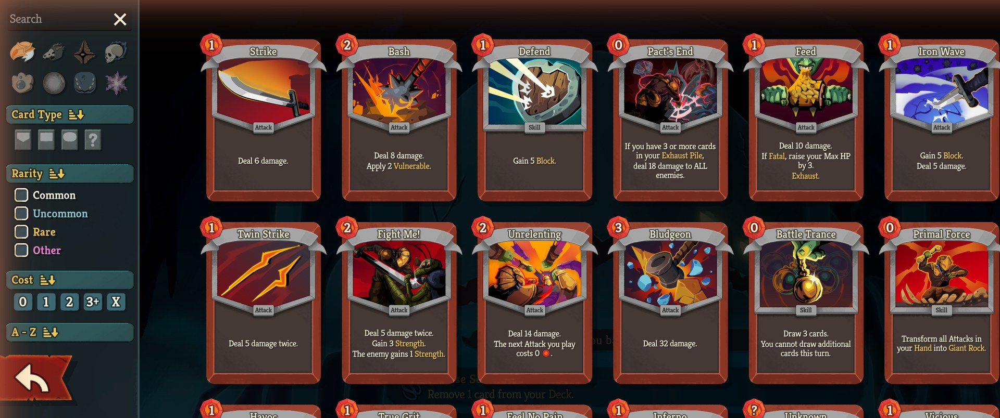

# Card Rarity Randomizer

A Slay the Spire 2 mod. At the start of every run the rarity of every card is shuffled, and a summary screen shows what changed. A Strike might be a Rare, and Whirlwind a Common.

## Screenshots

### Summary screen (run start)
Lists every card that changed rarity this run, with quick access to the Card Library.



### Card Library with shuffled rarities
Press **F8** during a run (or use the summary screen's button) to browse every card with its new rarity.



---

## What it does

- **Easy pre-run toggle:** Turn the randomizer ON or OFF directly from the Character Select screen or Custom Run screen before embarking. No need to quit and restart the game. To prevent broken decks and inconsistent reward distributions, the setting is locked once a run begins.
- **Shuffles inside each card pool:** Common, Uncommon and Rare cards swap rarities with other cards of the same pool, so each character keeps exactly as many Commons, Uncommons and Rares as before. Only the identities change.
- **Leaves special cards alone:** Basic, Ancient, Curse, Status, Quest and Event cards keep their rarity.
- **Fixed for the whole run, and repeatable:** The table comes from the run's seed, so the same seed gives the same rarities, and loading a saved run restores them. Rewards, shops and other rarity rolls follow the new rarities.
- **In-game Card Library hotkey (F8):** Press **F8** at any point during a run to instantly open the in-game Card Library (Compendium) and see every card with its active, randomized rarity.

## Install

1. Build it (below) or download it from the Steam Workshop.
2. Put `CardRarityRandomizer.dll` and `CardRarityRandomizer.json` in `<Slay the Spire 2>/mods/CardRarityRandomizer/`.
3. Restart the game and enable the mod in Settings > Mod Settings.

It changes gameplay, so everyone in a multiplayer lobby needs the mod. It has no dependencies and no `.pck`. Built for game version 0.111.0.

## Build

```
dotnet build mods/CardRarityRandomizer -c Release
```

The build copies the `.dll`, `.pdb` and `.json` into the game's `mods/CardRarityRandomizer/` folder (this fails while the game is running). The game path is found by `build/Sts2PathDiscovery.props`; override it with `/p:Sts2Path=...`.

Generate the preview art with:
```
python build/make_screenshots.py
```

## How it works

Code is in `src/`:

| File | Role |
| --- | --- |
| `MainFile.cs` | `[ModInitializer]` entry point |
| `Settings.cs` | Persists mod enabled state and per-run records to `<user data>/CardRarityRandomizer/settings.json` |
| `TogglePatch.cs` | Adds the one-click toggle button to `NCharacterSelectScreen` and `NCustomRunScreen`, and hooks the `F8` hotkey |
| `RarityPatches.cs` | Harmony postfixes on `RunManager.InitializeNewRun`, `InitializeSavedRun`, `CleanUp`, and `CardModel.Rarity` getter |
| `Randomizer.cs` | The seeded shuffle, one pool at a time (SHA-256 of seed and pool, so it is stable across processes) |
| `RarityState.cs` | The active run's rarity table and state |
| `SummaryScreen.cs` | The overlay, built from stock Godot nodes on its own `CanvasLayer` with on-screen toggle controls |
| `GameReflection.cs` | Looks game members up by name; the one place to fix after a game update |

Unofficial fan-made mod, not affiliated with Mega Crit.
