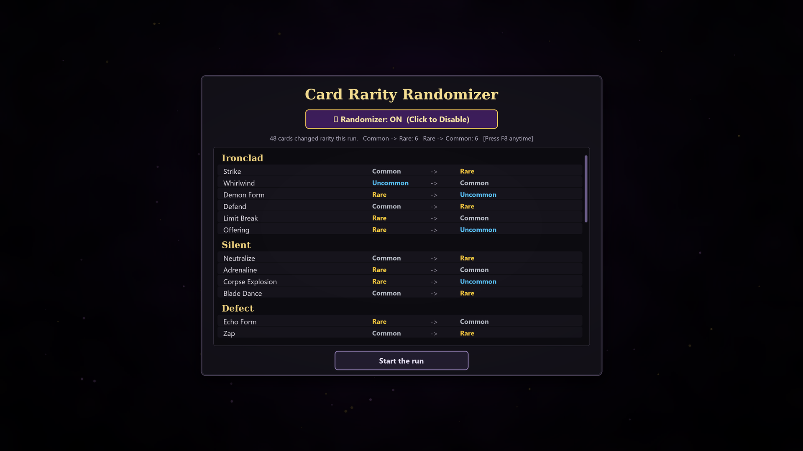
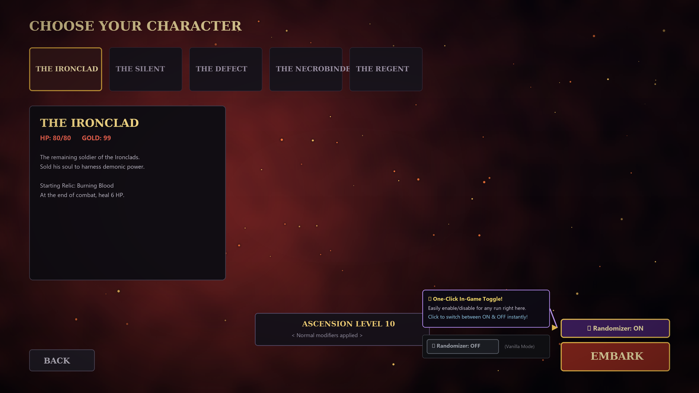
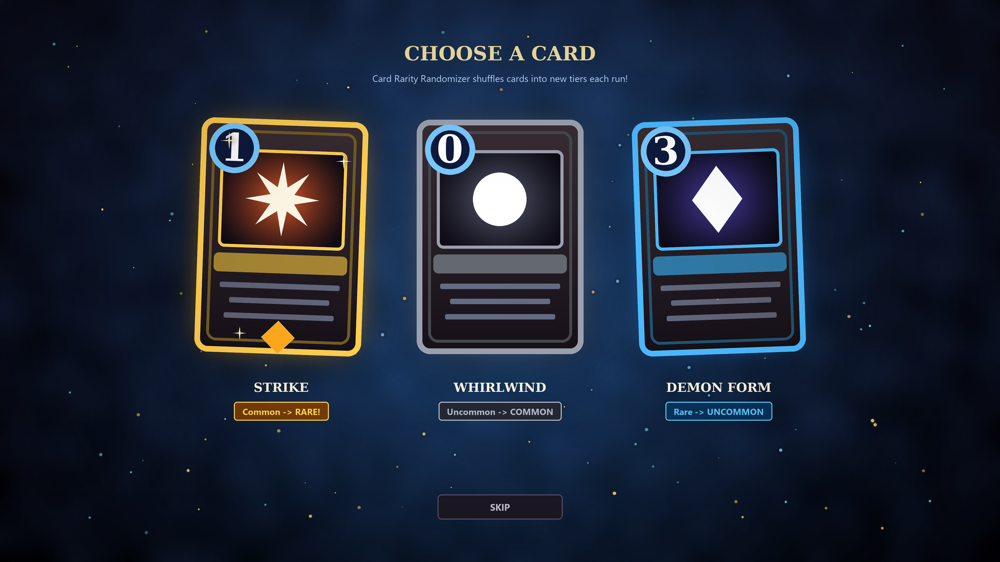

# Card Rarity Randomizer

A Slay the Spire 2 mod. At the start of every run the rarity of every card is shuffled, and a summary screen shows what changed. A Strike might be a Rare, and Whirlwind a Common.

## Screenshots

### 1. Summary Screen (Run Start & F8 Hotkey)
Lists every card that changed rarity this run, sorted by character pool with the biggest jumps first. Includes an on-screen toggle to enable or disable the randomizer at any time.



### 2. In-Game Toggle (Character Select & Custom Run)
Easily toggle between randomized runs and standard vanilla runs with a single click right before embarking—no game restart required!



### 3. Shuffled Card Rewards
Card rewards, shops, and rarity-based mechanics follow the new shuffled rarities!



---

## What it does

- **Easy in-game toggle:** Turn the randomizer ON or OFF directly from the Character Select screen, Custom Run screen, or during a run via the Summary Screen. No need to quit and restart the game.
- **Shuffles inside each card pool:** Common, Uncommon and Rare cards swap rarities with other cards of the same pool, so each character keeps exactly as many Commons, Uncommons and Rares as before. Only the identities change.
- **Leaves special cards alone:** Basic, Ancient, Curse, Status, Quest and Event cards keep their rarity.
- **Fixed for the whole run, and repeatable:** The table comes from the run's seed, so the same seed gives the same rarities, and loading a saved run restores them. Rewards, shops and other rarity rolls follow the new rarities.
- **In-run inspection (F8):** Press **F8** at any point during a run to view the summary screen and check what changed, or toggle the randomizer on/off on the fly.

## Install

1. Build it (below) or download it from the Steam Workshop.
2. Put `CardRarityRandomizer.dll` and `CardRarityRandomizer.json` in `<Slay the Spire 2>/mods/CardRarityRandomizer/`.
3. Restart the game and enable the mod in Settings > Mod Settings.

It changes gameplay, so everyone in a multiplayer lobby needs the mod. It has no dependencies and no `.pck`. Built for game version 0.111.0.

## Build

```
dotnet build mods/CardRarityRandomizer -c Release
```

The build copies the `.dll`, `.pdb` and `.json` into the game's `mods/CardRarityRandomizer/` folder (this fails while the game is running). The game path is found by `build/Sts2PathDiscovery.props`; override it with `/p:Sts2Path=...`.

Generate screenshots and preview art with:
```
python build/make_screenshots.py
```

## How it works

Code is in `src/`:

| File | Role |
| --- | --- |
| `MainFile.cs` | `[ModInitializer]` entry point |
| `Settings.cs` | Persists mod enabled state and per-run records to `<user data>/CardRarityRandomizer/settings.json` |
| `TogglePatch.cs` | Adds the one-click toggle button to `NCharacterSelectScreen` and `NCustomRunScreen`, and hooks the `F8` hotkey |
| `RarityPatches.cs` | Harmony postfixes on `RunManager.InitializeNewRun`, `InitializeSavedRun`, `CleanUp`, and `CardModel.Rarity` getter |
| `Randomizer.cs` | The seeded shuffle, one pool at a time (SHA-256 of seed and pool, so it is stable across processes) |
| `RarityState.cs` | The active run's rarity table and state |
| `SummaryScreen.cs` | The overlay, built from stock Godot nodes on its own `CanvasLayer` with on-screen toggle controls |
| `GameReflection.cs` | Looks game members up by name; the one place to fix after a game update |

Unofficial fan-made mod, not affiliated with Mega Crit.
