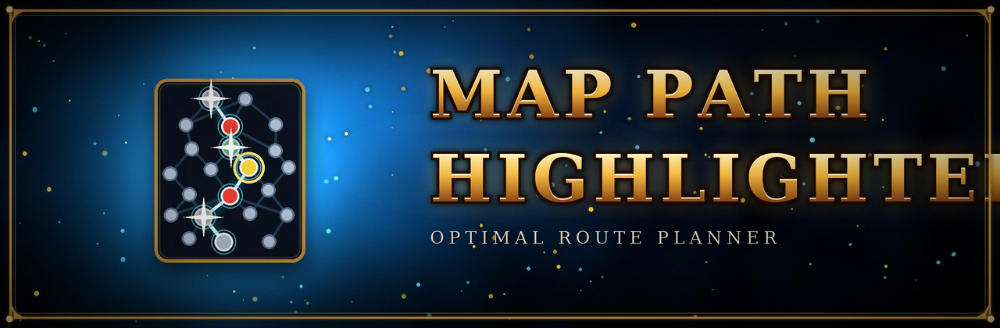
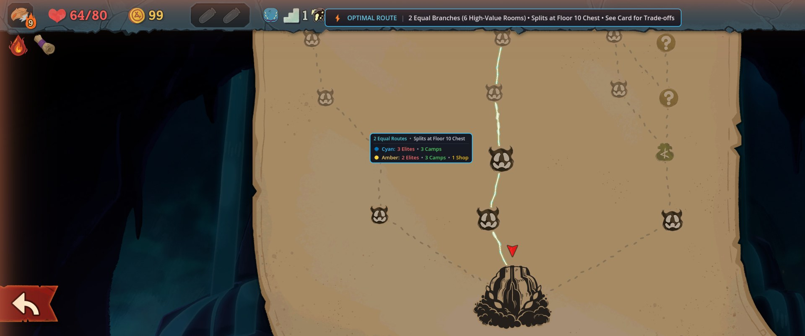
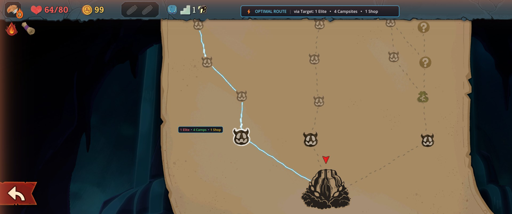
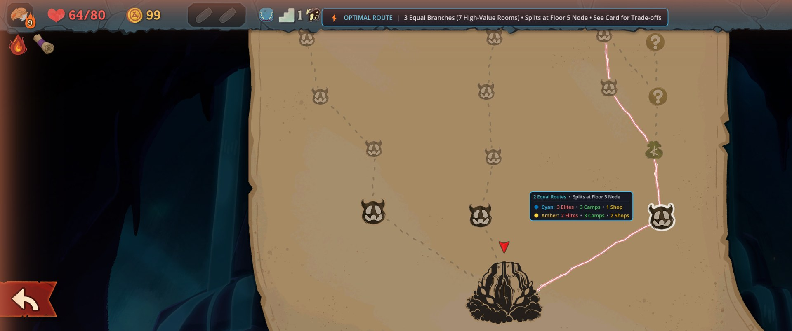

<p align="center"></p>

# Map Path Highlighter

An interactive map pathfinding and route preview mod for Slay the Spire 2. Code-only (Harmony patches): no BaseLib, no `.pck`, no external dependencies.

Hover over any destination node on the map screen (such as a campsite, shop, elite, or the boss) to dynamically calculate and highlight the optimal route leading through it, animated with an electric current surging upward from the bottom towards the top of the map.

## Screenshots

Hovering a node previews the optimal route; when several routes tie, every branch is highlighted and a compact icon badge beside the node shows the room counts:







## Features

- **Hover Route Preview**: Hover over any node on the map to preview the optimal path from your current location (or from the start of the act) passing through that node to the boss.
- **Multi-Branch Exploration**: When multiple routes tie for the maximum number of high-value nodes, the mod highlights **all equal branches** simultaneously so you can compare optimal alternatives side-by-side.
- **On-Map Icon Badges**: A compact floating badge appears directly next to the hovered node showing game room icons and counts for high-value encounters along the route (Elites, Rest Sites, Shops), with color dots for each branch when multiple routes have different trade-offs.
- **High-Value Optimization**: Evaluates reachable paths to maximize the sum of:
  1. **Elites** (relics, rare card rewards, gold)
  2. **Rest Sites / Campsites** (upgrades and heals)
  3. **Shops / Merchants** (cards, relics, removals)
- **Synchronized Electrical Current Animation**: Renders an electric current flowing upward from bottom to top along all active branches, complete with neon glow lines and white-hot traveling energy pulses.
- **Controller & Mouse Support**: Fully responsive to both mouse hover and gamepad / controller directional navigation.
- **Client-Side Only**: Does not alter game logic (`affects_gameplay: false`), so it works seamlessly in multiplayer lobbies without requiring other players to have the mod installed.

## Install

Subscribe on the Steam Workshop, or build it yourself (below) and restart the game; mods load only at startup. Enable it under **Settings > Mod Settings**.

## Build

```bash
dotnet build mods/MapPathHighlight -c Release
```

Requires Slay the Spire 2 installed. The build automatically compiles against the game's assemblies (`sts2.dll`, `GodotSharp.dll`, `0Harmony.dll`) and copies the output `.dll`, `.pdb`, and manifest `.json` into `<Slay the Spire 2>/mods/MapPathHighlight/`.

## Architecture & Internals

- `PathOptimizer.cs`: Dynamic programming algorithm operating over the map DAG. Given a target node and current player location (or row 0 start nodes), computes all optimal incoming paths and outgoing paths maximizing high-value rooms.
- `RouteScore.cs`: Value struct representing room counts with comparison logic for high-value rooms, elites, campsites, and shops.
- `MapPathAnimator.cs`: Visual controller managing Godot stock nodes (`Line2D` glow arcs and compact icon-based on-map badges) and animating the electric current wave along the path's dot texture nodes.
- `MapPatches.cs`: Harmony postfixes on `NMapPoint.OnFocus`, `NMapPoint.OnUnfocus`, `NMapScreen._Process`, and screen transition handlers.

Built against game version 0.111.0. Unofficial fan-made mod, not affiliated with Mega Crit.
