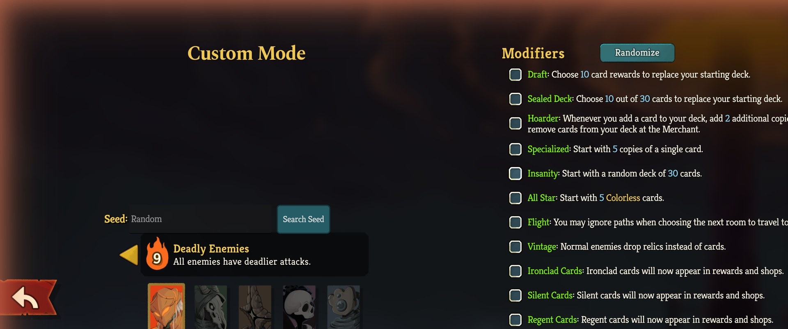
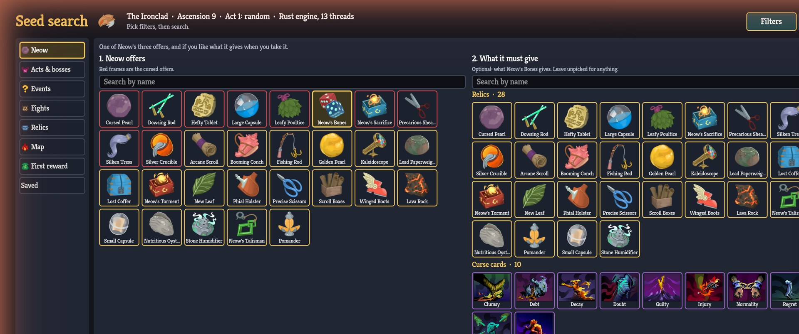

<p align="center"></p>

# Seed Search

Find the seed you want before the run starts. A **Search Seed** button on both the **Standard Run (Character Select)** and **Custom Run** screens (singleplayer) opens a full-screen search where you pick what you want from the game's own icons.

## Features

- **Standard & Custom Runs**: Start a seeded Standard Run directly from the Character Select screen (keeping normal unlocks & achievements enabled) or fill the seed box on the Custom Run screen.
- **Comprehensive Filters**:
  - **Neow**: Neow's 3 relic offers, what they give when taken (including nested `Neow's Bones` relic chains), and how each Neow choice changes the Floor 1 card reward.
  - **Ancients (Act 2 & 3)**: Which Ancient spawns and the exact 3 relics offered by `Orobas`, `Pael`, `Tezcatara`, `Nonupeipe`, `Tanx`, `Vakuu`, and `Darv` (including `Dusty Tome`).
  - **Chests & First Shop**: Treasure Chest relics (rolled from the shared bag), Reward/Shop relic bags, and the complete **First Shop Inventory** (5 character cards + 50% On Sale card, 2 colorless cards, 3 shop relics, and 3 potions).
  - **Acts, Fights & Events**: Act 1 biome (`Overgrowth` / `Underdocks`), act bosses (including Double Boss at Ascension 10), and the queue order of events, normal fights, and elites.
  - **Maps & Single-Path Reachability**: Filter by either **Single-Path Max** (maximum Elites, Rest Sites, Shops, or `?` rooms reachable on one legal path via DAG dynamic programming) or total map room counts, with 1-click presets (`≥3 Elites on path`, `≥4 Rests on path`, etc.).
  - **`OR` ("Any Of") Groups & 1-Click Editing**: Click any item to add a filter immediately, adjust `within first N` or `min..max` ranges in-place with `- / +` steppers, and combine alternatives into `OR` groups.
- **Rich Seed Preview**: Inspect Neow offers & post-Neow Floor 1 rewards, First Shop inventory (with `"50% SALE"` badge), Treasure Chest relics, Act 2/3 Ancient relic offerings, expandable full queues/bags, and Act 1–3 maps with active filter match highlighting (`★`), hover tooltips, and **Copy summary**.
- **Keep What You Find**: Bookmark seeds with a note; recent searches (last 12) and kept searches are saved in `%APPDATA%/SlayTheSpire2/RasmusSlayTheSpire2Mod/seed_search.json`.
- **Fast Multi-Core Rust Engine**: Searches millions of seeds per second across all CPU cores (Windows x64), verified on startup against the game's own C# simulation.

## Screenshots

The Search Seed button next to the seed box on the Custom Run screen:



The filter panel, with a filter added:



## Layout

```
RasmusSlayTheSpire2Mod.csproj / .json   project and mod manifest (id kept from v1 so the Workshop item stays the same)
MainFile.cs                              entry point, applies the Harmony patches
src/                                     seed search UI, simulator, native engine bindings
seed-engine/                             Rust crate built to sts2_seed_engine.dll
workshop/                                Workshop item metadata (title, description, image, mod_id.txt)
art/                                     icon and banner
```

See the repository `CLAUDE.md` for how the engine and the game code are kept in sync.

## Build

```
dotnet build mods/SeedSearch -c Release
```

On Windows this first runs `cargo build --release` in `seed-engine/` (needs Rust; skip with `/p:SkipRustBuild=true`), then copies the `.dll`, `.pdb`, `.json` and `sts2_seed_engine.dll` to `<Slay the Spire 2>/mods/RasmusSlayTheSpire2Mod/`. Offline engine tests: `cargo test --release --manifest-path mods/SeedSearch/seed-engine/Cargo.toml`.

Built against game version 0.111.0. Unofficial fan-made mod, not affiliated with Mega Crit.

## Upgrading from v1.x

The card tweaks that used to ship in this mod (Master Planner) moved to the separate [Balance Tweaks](../CardBalance/) mod.
